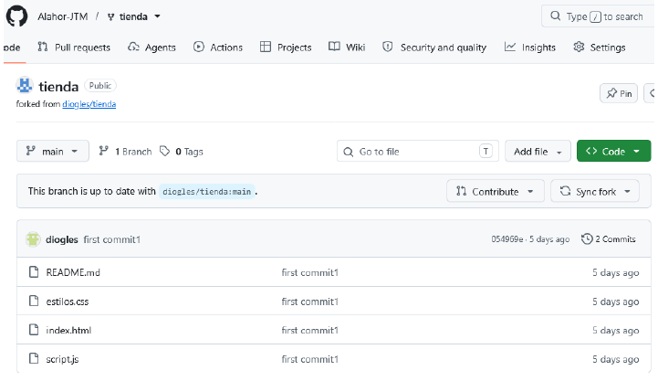

# Documentación del LABORATORIO 03
## INTRODUCCIÓN
Esta documentación explicará como crear tu propio Fork en GitHub
### 1. Requisitos Previos
Antes de iniciar, debes haber iniciado sesión en tu GitHub. Recordarás que un Fork es tu copia personal del repositorio de otra persona. Se crea en tu cuenta, es tuya y puedes romperla sin miedo: el original no se entera. Y hay un detalle que lo hace especial: GitHub recuerda de dónde salió tu copia, y gracias a eso podrás proponerle cambios más adelante, ya se para corregir algún error o para mejorar el código de la otra persona.
### 2. Procedimiento
1. **Comprobar que iniciaste sesión en GitHub.** Arriba a la derecha debe verse tu avatar. Si ves los botones Sign in / Sign up, todavía no has iniciado sesión y el botón Fork no aparecerá.
2. **Hacer clic en el botón Fork.** Está arriba a la derecha, al lado de Star y Watch.
3. **Confirmar la creación.** GitHub muestra un formulario. Deja todo como viene:

| Campo  | ¿Qué debe decir? |
|--------|------------------|
| Ownwer | Tu propio usuario de GitHub..|
| Repository name | tienda |
| Copy the main branch only | Marcado. |

Haz clic en el botón verde Create fork y espera unos segundos.

### Control de Progreso de la Guía
- [x] Crear el Fork del repositorio en la web.
- [x] Verificar el cambio de dueño en la barra de direcciones.
- [ ] Configurar el repositorio local en la consola.

## VERIFICACIÓN Y RESULTADOS

### Resultado Esperado
La dirección del navegador cambia a `github.com/TU-USUARIO/tienda-tecsup` y, debajo del nombre del repositorio, aparece en letra pequeña: *forked from DOCENTE/tienda-tecsup*.

> **Cuidado:** Comprueba que la barra de direcciones diga TU usuario y no el del docente. Si sigue diciendo el del docente, el fork no se creó, y todo lo que hagas después fallará con un error de permisos.

### Comandos de Consola Útiles
Una vez creado el fork, puedes clonar tu proyecto usando el comando `git clone` o verificar el estado de tus archivos locales con el siguiente comando:

```bash
git status
```

## Captura del Resultado
